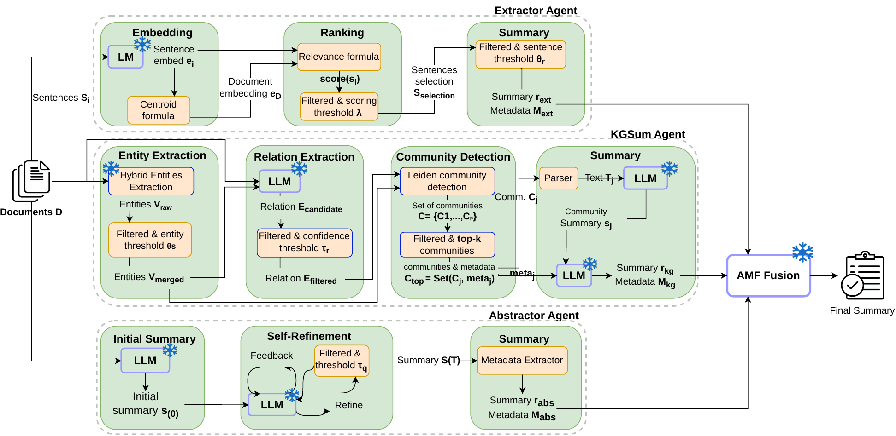

# A Training-Free Mixture-of-Agents Framework for Multi-Document Summarization using LLMs and Knowledge Graphs

[](https://github.com/cngvng/MoA-MDS/actions/workflows/ci.yml)
[](LICENSE)
[](https://doi.org/10.1007/s00521-026-12249-y)

This repository contains the release implementation for the paper:

**A Training-Free Mixture-of-Agents Framework for Multi-Document Summarization using LLMs and Knowledge Graphs**  
Published in **Neural Computing and Applications**, **38**, article **538**,
23 June **2026**. [Paper / DOI](https://doi.org/10.1007/s00521-026-12249-y)
· [Project website](https://vnpt-ai-official.github.io/NCA2026-MoA-MDS/)

**Code release maintained by: Tuan-Cuong Vuong**  
First author of the paper and maintainer of this implementation.

MoA-MDS combines extractive selection, knowledge-graph summarization, and
abstractive refinement with Adaptive Multi-Perspective Fusion (AMF). It supports
four English/Vietnamese dataset adapters and OpenAI-compatible hosted or local
inference endpoints without task-specific fine-tuning.

This is an early-stage research implementation. Offline CI checks code behavior
with synthetic inputs; published benchmark scores require separate experiments
with the paper's dataset selection, models, prompts, and evaluation settings.




## Installation

This project uses `uv` for Python environment and dependency management.

```bash
curl -LsSf https://astral.sh/uv/install.sh | sh
git clone https://github.com/cngvng/MoA-MDS.git
cd MoA-MDS
uv sync --locked
```

Create your environment file:

```bash
cp .env.example .env
```

For OpenAI-compatible hosted models, set:

```bash
OPENAI_API_KEY=...
```

The default release config uses `gpt-5-nano` for one-sample pipeline checks.
Hosted runs incur provider charges and do not establish reproduction of the
paper's scores. Edit [configs/agents/default.yaml](configs/agents/default.yaml)
or [configs/base.yaml](configs/base.yaml) to change:

```yaml
llm:
  model_id: "gpt-5-nano"
  base_url:
  api_key_env: "OPENAI_API_KEY"
```

## Self-Hosted Models

The LLM wrapper is OpenAI-compatible. To use an open-source model, start an OpenAI-compatible endpoint and update `llm.model_id` and `llm.base_url`.

Ollama example:

```bash
ollama serve
ollama pull llama3.1
```

```yaml
llm:
  model_id: "llama3.1"
  base_url: "http://localhost:11434/v1"
  api_key_env: "OPENAI_API_KEY"
```

vLLM example:

```bash
vllm serve meta-llama/Llama-3.1-8B-Instruct --host 0.0.0.0 --port 8000
```

```yaml
llm:
  model_id: "meta-llama/Llama-3.1-8B-Instruct"
  base_url: "http://localhost:8000/v1"
  api_key_env: "OPENAI_API_KEY"
```

For llama.cpp, run its OpenAI-compatible server and set `base_url` to that server's `/v1` endpoint.

## Data

The four release datasets are:

| Dataset key | Language | Upstream source |
| --- | --- | --- |
| `multi_news` | English | [Multi-News](https://aclanthology.org/P19-1102/) |
| `multi_xscience` | English | [Multi-XScience](https://github.com/yaolu/Multi-XScience) |
| `vn_mds` | Vietnamese | [VietnameseMDS](https://github.com/lupanh/VietnameseMDS) |
| `vims` | Vietnamese | [ViMs](https://github.com/CLC-HCMUS/ViMs-Dataset) |

Dataset content retains its upstream license and access terms. It is not
relicensed by this repository's MIT license.

Download raw datasets:

```bash
ROOT_DIR=/data/mds HF_CACHE_DIR=/data/hf_cache DATASETS=all \
  bash scripts/download_raw_datasets.sh
```

Raw data, processed data, and output paths are configured in
[configs/storage.yaml](configs/storage.yaml). Before running, edit `global.*`,
`workspace.*`, and `output_root` to use writable paths on your machine. Set the
raw paths to match the download's `ROOT_DIR`; changing that shell variable does
not update the YAML. The current default processed layout is:

```text
/data/moa/processed/
  multinews/test.jsonl
  multixscience/test.jsonl
  vnmds/test.jsonl
  vims/test.jsonl
```

Prepare/check one normalized sample:

```bash
uv run python -m src.data.main --dataset multi_news --split test --num-samples 1
uv run python -m src.data.main --dataset multi_xscience --split test --num-samples 1
uv run python -m src.data.main --dataset vn_mds --split test --num-samples 1
uv run python -m src.data.main --dataset vims --split test --num-samples 1
```

Each sample follows:

```python
{
    "sample_id": str,
    "dataset_name": str,
    "split": str,
    "language": "en" | "vi",
    "documents": list[str],
    "reference_summary": str,
    "metadata": dict,
}
```

## One-Sample Reproduction

Run one sample through the full MoA release path:

```bash
uv run python -m src.run --dataset multi_news --split test --num-samples 1
```

Or use the dataset scripts:

```bash
scripts/run_one_multi_news.sh
scripts/run_one_multi_xscience.sh
scripts/run_one_vn_mds.sh
scripts/run_one_vims.sh
```

Case-study artifacts are written under:

```text
/data/moa/outputs/{dataset_name}/case_studies/{sample_id}_moa/
  agent_log.json
  metadata.json
  final_summary.txt
  reference_summary.txt
  knowledge_graph.json
```

`knowledge_graph.json` stores the KGSum case graph for later KG metrics:

```text
nodes, edges, communities, community_summaries, graph_metrics, centrality, key_entities
```

## Full Main-Results Runs

The full scripts are nohup-capable and support resume/skip-existing:

```bash
nohup scripts/run_multi_news.sh > logs/main_results/multi_news_full.nohup.log 2>&1 &
nohup scripts/run_multi_xscience.sh > logs/main_results/multi_xscience_full.nohup.log 2>&1 &
nohup scripts/run_vn_mds.sh > logs/main_results/vn_mds_full.nohup.log 2>&1 &
nohup scripts/run_vims.sh > logs/main_results/vims_full.nohup.log 2>&1 &
```

Create the log directory first with `mkdir -p logs/main_results`. Full runs may
make many model calls. Review sample counts, output paths, and provider costs
before starting. See [reproducibility notes](docs/REPRODUCIBILITY.md) for what to
record and the limits of the default settings.

## Development and maintenance

Run the offline checks without API keys or downloaded datasets:

```bash
uv sync --locked --group dev
uv run --locked python -m pytest
uv run --locked python -m compileall -q src scripts tests
```

Tests cover all four dataset adapters, configuration overlays, LLM request and
response handling with a mocked SDK call, and case-study artifact generation
with an injected synthetic LLM. Network access is blocked during tests.
GitHub Actions runs the suite on Python 3.10 and 3.12.

See [CONTRIBUTING.md](CONTRIBUTING.md), the [maintenance roadmap](ROADMAP.md), and
[issue templates](https://github.com/cngvng/MoA-MDS/issues/new/choose).

## License

The repository's code is available under the [MIT license](LICENSE). Third-party
datasets, model weights, dependencies, and the published article retain their
respective licenses and terms.

## Citation

Publication names below follow the publisher's citation metadata. The code
maintainer uses the name Tuan-Cuong Vuong. GitHub can also read [CITATION.cff](CITATION.cff).

```bibtex
@article{Tuan2026MixtureAgents,
  title = {A training-free mixture-of-agents framework for multi-document summarization using {LLMs} and knowledge graphs},
  author = {Tuan, Cuong Vuong and Xuan, Trang Mai and Nguyen, Tien-Cuong and Ngo, Vu-Duc and Luong, Thien Van},
  year = {2026},
  journal = {Neural Computing and Applications},
  volume = {38},
  pages = {538},
  doi = {10.1007/s00521-026-12249-y},
  url = {https://doi.org/10.1007/s00521-026-12249-y}
}
```
